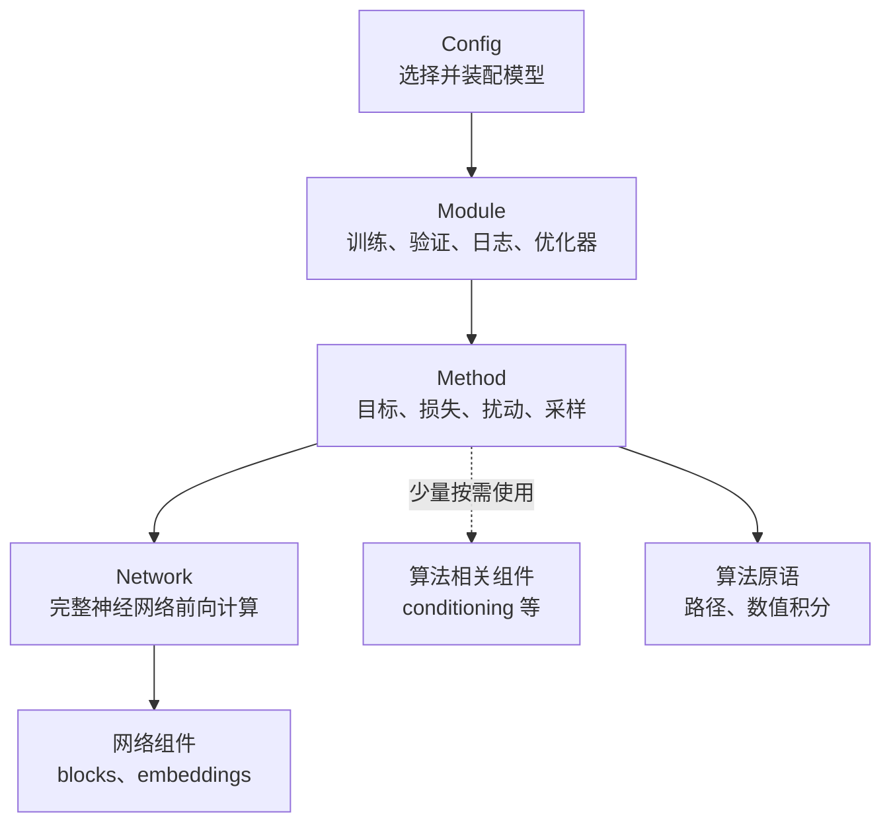
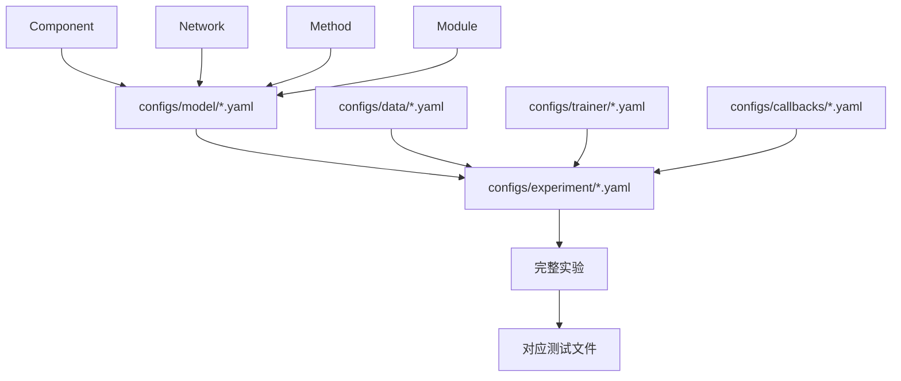
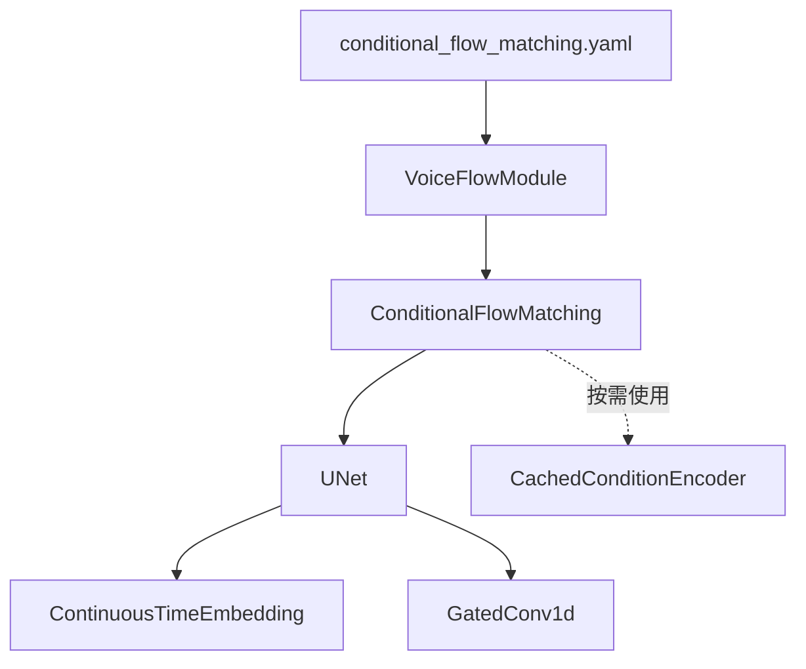

# `src/models` 结构说明

本项目定位为基于 PyTorch、Lightning 和 Hydra 的通用深度学习研究实验模板，不是新的底层训练框架。通用性由契约兼容、组件组合和实验验证体现，不代表已经实现所有领域或执行后端。

## 目录结构

```text
src/models/
├── components/                # 可复用的小组件
│   ├── blocks/                # 卷积、Transformer、波形处理块
│   ├── conditioning/          # 内容和说话人条件编码
│   └── embeddings/            # 连续时间、离散时间嵌入
├── networks/                  # 独立的完整神经网络
│   ├── dense/                 # 全连接网络家族
│   ├── unet/                  # U-Net 网络家族
│   └── transformer/           # Transformer、DiT 网络家族
├── methods/                   # 算法目标、损失和采样过程
│   ├── discriminative/        # 分类方法
│   ├── representation/        # AE、掩码重构等表征学习
│   └── generative/            # VAE、GAN、扩散、Flow Matching
├── algorithms/                # 不依赖具体模型和训练框架的算法原语
│   └── flow.py                # 线性概率路径、可微 Euler 积分
└── modules/                   # Lightning 生命周期、Batch 适配和优化流程
```

## 依赖关系



主要所有权关系：

```text
Config
└── Module
    └── Method
        ├── 一个或多个 Network
        │   └── 网络组件
        └── 少量算法相关组件（可选）
```

底层不能反向依赖上层：Network 不应依赖 Method 或 Lightning，Component 不应知道具体模型算法。Method 只在条件构造等无法归入 Network 的场景下直接使用少量 Component。

算法原语不依赖具体 Method、Network 或 Lightning。现有损失与优化工具继续位于 `src/losses/`、`src/optim/`，不另建重复的 Objectives 目录。当前没有独立推理编排包或自定义训练循环后端。

## 各层职责

### `components/`

提供局部、可复用的小组件。时间嵌入、门控卷积和 Transformer Block 主要由 Network 使用；MeanVC 条件编码等算法输入组件可以由 Method 按需使用。PyTorch 已提供的普通层直接使用，不重复封装。

### `networks/`

提供具有明确输入输出契约的完整参数化函数，只负责前向计算。顶层子目录按 Dense、U-Net、Transformer 等主要架构家族划分；目录内文件再表达条件形式、数据形态或复合接口。详细规则见 `src/models/networks/README.md`。

### `methods/`

组织一个或多个 Network，定义如何训练和生成，包括损失、时间或噪声采样、概率路径、扩散过程和 Flow 积分。同一个 Method 可以组合兼容的不同 Network，并仅在必要时持有条件编码等少量 Component。

### `algorithms/`

保存具有明确数学语义和实际复用需求的算法原语。`linear_path()` 仅计算确定性插值；`euler_integrate()` 接受向量场和初始状态，在 `[0, 1]` 上积分，不采样噪声、不切换模型模式、不关闭梯度，因此也可用于可微训练。Method 仍负责初始分布、条件绑定、Mask、生成入口及推理时的梯度上下文。

### `modules/`

持有 Method，负责 Lightning 生命周期、Batch 适配、指标记录、优化器、调度器和检查点兼容。Module 按训练生命周期和 Batch 契约分类，不按 Network 架构或 Method 算法分类；多个 Method 训练流程相同时可以复用同一个 Module。详细规则见 `src/models/modules/README.md`。

## 接口与状态契约

四层只在契约兼容时可替换，不要求统一 `forward()` 或继承万能基类。Method、Network、Component 不得导入 Lightning；可以直接用 PyTorch 计算损失、反传和生成。

| 边界         | 必须说明的内容                                                  |
| ------------ | --------------------------------------------------------------- |
| Network 输入 | 张量维度、轴顺序、DType/Device 约束、时间字段、条件与 Mask 含义 |
| Network 输出 | 形状、参数化语义，例如速度、噪声、分数或分类 logits             |
| Method 训练  | 输入契约、损失归约、返回结果、梯度流与随机数来源                |
| Method 生成  | 条件、初始分布、积分或解码方式、Mask 和输出语义                 |
| Module 执行  | Batch 转换、指标、优化角色、调度器推进和恢复要求                |

静态能力接口按实际网络族按需定义，不强制添加 Protocol。静态类型不能代替 Shape 和目标语义校验；当前 Flow 在训练和积分边界拒绝不匹配的向量场输出形状。

Component、Network、Method 都可以拥有 Parameter 和 Buffer。Method 通过 `nn.Module` 注册其模型、可训练条件编码器和额外算法状态；Module 只注册 Method，不再保存同一网络的重复模块别名。参数共享必须显式设计，不能通过复制模型冒充共享。

GAN 的 `optimization_roles()` 返回具名参数元组，并检查非空、组内重复、Method 参数归属、角色交集和可训练参数覆盖。当前 GAN 不支持跨优化器共享参数；其他算法确需共享时应独立定义更新和恢复规则，不套用 GAN 的限制。

冻结需要区分参数梯度、优化器更新、Buffer 和 train/eval 模式。冻结参数不保证 BatchNorm 状态不变，也不自动关闭 Dropout。当前 GAN 保持原有模式与 Buffer 更新行为，不把非更新角色的全部状态不变作为断言。

## 优化阶段契约

Method 定义阶段目标、梯度截断、样本复用与算法要求的阶段顺序。GAN 声明 `optimization_phases = ("discriminator", "generator")`，由 `compute_phase_loss()` 分别生成样本并构造阶段目标；判别器阶段对生成样本执行 `detach()`。

Module 根据声明切换优化器、清梯度、反传和更新，并在异常时恢复参数的梯度开关。为兼容已有优化器状态，GAN 的优化器列表仍按 Generator、Discriminator 排列，执行顺序仍为 Discriminator、Generator。Module 不再访问具体网络的 G/D 参数。

当前 GAN 每个 Batch 各更新一次 G/D，不提供通用阶段调度器。多阶段频率、梯度累积、裁剪、精度策略和调度器推进若要扩展，必须明确执行语义并增加对应测试，不能假定自动优化设置对手动优化全部生效。

## 实验与恢复约定

- 配置继续以 `configs/model/*.yaml` 嵌套组装，实验配置选择数据、模型与执行设置；新增配置组由实际重复需求驱动。
- 可复现实验应记录解析后的配置、代码版本、依赖和硬件环境、数据划分/预处理版本、外部权重身份与评估设置。数据内容身份不是仅靠路径就能证明，当前没有全项目统一的自动数据版本快照。
- 训练显式设置 `seed`，包括合法的 `0`；固定评估应与训练随机流分离。当前条件语音评估支持固定种子多次计算，不代表所有生成接口都有独立 Generator。
- 权重加载只恢复模型状态；继续训练使用完整 Lightning 检查点和相同的模型/优化器参数角色，恢复优化器、调度器及进度。仅对可信来源的检查点执行反序列化。
- 精确续跑还需要验证 Python/NumPy/PyTorch/CUDA RNG、数据顺序、Worker、执行后端和确定性条件；本模板不承诺任意实验逐位续跑或跨硬件一致。
- 实验资源和权重不隐式下载；每次下载须事先获得用户同意。原始数据保持只读。

## 抽象与验证规则

公共实现应具有稳定的数学语义，并有至少两个实际调用场景，或明确的独立测试价值。若抽离引入更多适配而没有复用收益，优先保持局部实现；不预建尚无实现的模型家族目录。

沿用现有测试文件，按风险覆盖局部数值、接口契约、配置组合和实验生命周期，不要求按四级目录搬迁。当前新增验证包括 GAN 参数角色与阶段梯度/Buffer/RNG、Flow 数值及梯度等价、错误形状拒绝、CFM 无 Lightning 网络替换，以及 GAN 双优化器和 Flow 调度器的检查点恢复。

同环境下未改变运算路径的重构优先要求精确一致，包括随机采样与 RNG 状态；发生合理浮点路径变化时，使用有依据的数值容差。通过局部测试不代表已验证 GPU、分布式或所有领域。

## 配置组装与实验测试

`src/models/` 通过分层实现代码解耦，但实际运行时由 Hydra 配置把各层重新组装成完整实验：



- `configs/model/*.yaml` 组装 Module、Method、Network 和 Component，形成完整模型。
- `configs/experiment/*.yaml` 继续选择数据、模型、Trainer 和 Callback，形成可运行实验。
- `tests/models/test_*.py` 不只测试单个类，还应验证该实验对应的 Network、Method 和 Module 能否正确协作。
- 配置测试负责确认 Hydra 可以实例化完整组合，实验测试负责确认损失、梯度、预测和训练生命周期符合预期。

因此，目录分层用于复用和维护，配置负责组合，测试负责验证组合后的实验行为。

## 示例


