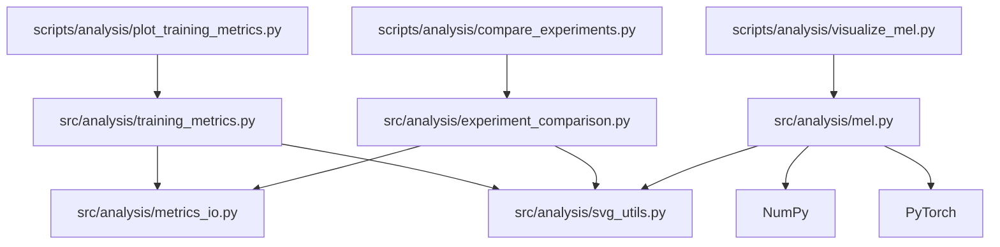

# 分析模块说明

`audit_meanvoiceflow_implementation.py` 使用本地 `pdftotext` 提取论文，核查 B3 配置/权重并复现实测 padding 偏差；不训练、不重新生成音频。报告和命令见[B3 论文实现核对](../../docs/diagnostics/B3%E8%AE%BA%E6%96%87%E5%AE%9E%E7%8E%B0%E6%A0%B8%E5%AF%B9_20261026.md)。

P4 身份诊断入口为 `evaluate_p4_identity.py`，`analyze` 复用已有 CSV/WAV，`score` 使用显式本地 CAMPPlus 权重，`sensitivity` 补充源/目标说话人及文本的三向聚类区间；均不训练、不生成新转换音频、不下载。协议、运行顺序及结果见[P4 报告](../../docs/diagnostics/P4%E6%BA%90%E8%BA%AB%E4%BB%BD%E7%8B%AC%E7%AB%8B%E9%AA%8C%E8%AF%81_20261026.md)。

研究阶段实现已归类到 `src/analysis/p1/`、`p2/`、`endpoint_pilot/`，本目录命令行文件名保持不变。当前结论见[阶段总结](../../docs/research/%E7%A0%94%E7%A9%B6%E9%98%B6%E6%AE%B5%E6%80%BB%E7%BB%93%E4%B8%8E%E4%B8%8B%E4%B8%80%E6%AD%A5%E5%86%B3%E7%AD%96_20261026.md)，具体实现导航见[分析模块](../../src/analysis/README.md)。以下训练命令用于复现，当前决策是先诊断、暂不扩展训练。

## 1. 组织方式

分析代码分为两层：

- **`src/analysis/`：可复用的分析模块。** 负责读取数据、统计指标、生成图表和摘要，可从其他 Python 程序或 Notebook 导入。
- **`scripts/analysis/`：命令行入口。** 使用 `argparse` 解析参数，调用分析模块，打印输出路径。不再独立实现分析算法。

训练曲线与张量等静态分析只读取已有文件；统一转换评估会加载训练配置和模型权重。P1 专用入口见第 8 节，运行评估不会启动训练。

## 2. 文件与职责

### 可复用模块

| 文件                                                                    | 职责                                           | 主要接口                                                                                            |
| ----------------------------------------------------------------------- | ---------------------------------------------- | --------------------------------------------------------------------------------------------------- |
| [metrics_io.py](../../src/analysis/metrics_io.py)                       | 定位 CSV、读取记录、提取指标序列、计算统计     | `resolve_metrics_csv()`、`read_metrics()`、`metric_points()`、`summarize_metric()`、`load_metric()` |
| [svg_utils.py](../../src/analysis/svg_utils.py)                         | 直接生成 SVG，不依赖第三方绘图库               | `write_line_chart()`、`write_bar_chart()`、`write_heatmap()`                                        |
| [training_metrics.py](../../src/analysis/training_metrics.py)           | 单次训练的曲线与统计摘要                       | `analyze()`                                                                                         |
| [experiment_comparison.py](../../src/analysis/experiment_comparison.py) | 多次实验的统计表与最优指标柱状图               | `compare()`                                                                                         |
| [mel.py](../../src/analysis/mel.py)                                     | 读取张量、选择样本、整理维度、绘制热力图与统计 | `visualize()`                                                                                       |

### 命令行入口

| 文件                                                 | 对应分析模块                         | 职责                                |
| ---------------------------------------------------- | ------------------------------------ | ----------------------------------- |
| [plot_training_metrics.py](plot_training_metrics.py) | `src.analysis.training_metrics`      | 单次训练分析入口                    |
| [compare_experiments.py](compare_experiments.py)     | `src.analysis.experiment_comparison` | 解析多个 `名称=路径` 参数并执行对比 |
| [visualize_mel.py](visualize_mel.py)                 | `src.analysis.mel`                   | Mel 可视化入口                      |

表中列出静态分析入口。共用工具在 `src/analysis/` 中维护，复用时直接从对应模块导入。

## 3. 依赖关系

下图中箭头表示“导入 / 调用”：



依赖方向是 **脚本 → 分析模块 → 共用工具**。`src/analysis/` 不反向导入 `scripts/analysis/`，因此复用时无需携带命令行脚本。

- 指标读取、训练分析、实验对比和 SVG 绘图仅依赖 Python 标准库。
- Mel 分析额外依赖 `numpy` 和 `torch`，读取张量时使用 CPU，不要求 GPU。
- `argparse` 和项目根目录的 `sys.path` 初始化只在脚本层使用。后者用于支持直接运行脚本。
- 复用模块时，项目根目录需要位于 Python 导入路径中。若迁入其他项目，应保留整个分析包及内部相对导入，并配置 NumPy / PyTorch（仅 Mel 任务需要）。

## 4. 命令行使用

以下命令在项目根目录执行；示例中的输入路径需替换为实际文件或目录。

### 单次训练分析

```bash
python scripts/analysis/plot_training_metrics.py /path/to/run \
  --metrics train/loss val/loss test/loss \
  --output-dir /path/to/output \
  --title "训练指标曲线"
```

- 输入可以是 CSV 文件或包含唯一 `metrics.csv` 的目录。
- 默认指标为 `train/loss`、`val/loss`、`test/loss`；没有有效数据的指标会被跳过，全部无效时报错。
- 不指定输出目录时，写入指标文件旁的 `analysis/`。
- 输出：`training_curves.svg`、`metrics_summary.json`。

### 多实验对比

```bash
python scripts/analysis/compare_experiments.py \
  --run B1=/path/to/run1 \
  --run B2=/path/to/run2 \
  --metric val/loss \
  --output-dir /path/to/comparison
```

- 至少指定两个实验，每个路径可以是 CSV 文件或运行目录。
- 默认比较 `val/loss`，默认输出到当前工作目录下的 `analysis_results/`。
- 输出：`experiment_comparison.csv`、`experiment_comparison.svg`。
- CSV 包含最优值、最终值、最优位置等统计，柱状图展示最优值。

### Mel 可视化

```bash
python scripts/analysis/visualize_mel.py /path/to/sample.pt \
  --key mel \
  --batch-index 0 \
  --max-frames 300 \
  --output-dir /path/to/mel_analysis
```

- 支持 `.pt`、`.pth`、`.npy`、`.npz`。
- 包含多个候选张量的字典或多个数组的 NPZ，需要通过 `--key` 选择。
- 三维输入使用 `--batch-index` 选择样本；可用 `--transpose` 交换两个维度。
- 不指定输出目录时，写入输入文件旁的 `analysis/`。
- 输出：`<输入文件名不含扩展名>_mel.svg`、`<输入文件名不含扩展名>_mel_stats.json`。
- 此工具读取已有张量，不负责将音频转换为 Mel，也不将 VCTK 内容特征或说话人向量自动转换为 Mel。

各入口均可使用 `--help` 查看参数。脚本支持从其他工作目录以绝对脚本路径启动，但相对输入路径仍以当前工作目录为基准。

## 5. Python 中复用

```python
from pathlib import Path

from src.analysis.training_metrics import analyze
from src.analysis.experiment_comparison import compare
from src.analysis.mel import visualize

chart_path, summary_path = analyze(
    input_path=Path("/path/to/run"),
    metrics=["train/loss", "val/loss"],
    output_dir=Path("/path/to/output"),
    title="训练指标曲线",
)

comparison_table, comparison_chart = compare(
    runs=[("B1", Path("/path/to/run1")), ("B2", Path("/path/to/run2"))],
    metric="val/loss",
    output_dir=Path("/path/to/comparison"),
)

mel_chart, mel_summary = visualize(
    input_path=Path("/path/to/sample.npy"),
    key=None,
    batch_index=0,
    transpose=False,
    max_frames=300,
    output_dir=Path("/path/to/mel_analysis"),
    title=None,
)
```

三个接口均返回两个输出文件的 `Path`，不会解析命令行或打印结果。函数参数没有默认值，调用时需显式传入；默认选项由脚本入口提供。

## 6. 当前行为与限制

- 指标横坐标优先使用有效的 `epoch`，其次使用 `step`，均无效时使用记录序号。同一位置的同一指标保留最后一个有效数值，然后按位置排序。
- 指标统计忽略空值、无法转换的值、NaN 和无穷值；“最终值”是排序后最后位置的值。
- 训练分析和实验对比通过指标名是否包含 `loss` 决定最优方向：包含时取最小值，否则取最大值。其他需要最小化的指标暂时不能通过命令行指定方向。
- Mel 在去除单例维度后选择样本、处理方向，并按 `max_frames` 均匀抽样。**当前 JSON 统计针对处理后的绘图矩阵，不一定代表完整输入。** 非有限值检查也发生在抽样之后。
- Mel 方向存在形状启发式推断，图表横轴是帧而非秒，纵轴是 Mel 通道而非 Hz。
- 输出目录自动创建；相同目录、相同输出文件名会覆盖原文件。重复分析需要保留历史结果时，请指定不同输出目录。
- PyTorch 文件使用 `weights_only=True` 读取，NumPy 文件使用 `allow_pickle=False`，不要为了读取不兼容文件而关闭这些限制。

## 7. 测试与维护

回归测试位于 [tests/analysis/test_analysis.py](../../tests/analysis/test_analysis.py)，包含指标统计、输出内容、Mel 抽样行为，以及三个脚本从外部工作目录运行 `--help` 的检查。

测试直接导入当前模块；目录迁移时需同步更新导入路径和命令行帮助检查。

在现有环境中可执行：

```bash
conda activate Lightning-Template
pytest tests/analysis/test_analysis.py
```

维护时遵循以下边界：

1. 分析算法、统计规则和绘图逻辑修改在 `src/analysis/` 完成。
2. 命令行参数、帮助信息和结果打印修改在 `scripts/analysis/` 完成。
3. 行为变化同步更新回归测试和本说明，不在脚本入口中复制业务代码。

## 8. 最新三组 P1 转换评估

专用入口 `evaluate_p1_latest.py` 绑定 2026-10-18/19/21 三个运行的最佳权重，评估 B1 的 1/5/10/50 NFE 和 B2/B3 的 1 NFE。B3 使用实际源 Mel、默认 `source_time=0.95`。只使用本地 Vocos、Whisper、WavLM+ECAPA；进程禁止网络连接。

```bash
conda activate Lightning-Template
python scripts/analysis/evaluate_p1_latest.py --output-dir analysis_results/p1_latest_20261024 --stage preflight --device cuda:0
python scripts/analysis/evaluate_p1_latest.py --output-dir analysis_results/p1_latest_20261024 --stage smoke --device cuda:0
python scripts/analysis/evaluate_p1_latest.py --output-dir analysis_results/p1_latest_20261024 --stage full --device cuda:0
```

首次执行必须指定不存在的新目录。预检保存固定 100 对清单、运行配置、资源与缓存指纹，并验证严格权重加载和 B3 的扩散真实源输入。冒烟使用前 2 对，写入 `smoke_corrected/`；通过后全量写入 `full/`。2026-10-24 首次旧适配冒烟留在 `smoke/`，已标记 `REJECTED.json`，不可纳入正式结果。

P1 使用 `power_mel_adapter.py`：源 HTK 功率频带除以滤波器质量，开方得到带内平均幅度，再插值并经 Vocos 权重内的真实 Slaney 滤波器积分。它是固定近似，不能恢复功率 Mel 已丢失的频谱细节；原音和同链路重建对照用于判断残余损耗。未修改旧评估模块的适配或训练方法。

每阶段保存 Mel、浮点 WAV、逐样本与聚合 CSV、F0/清浊音/能量轨迹、代码快照及 GPU 状态。源韵律按真实时间比较；参考韵律按归一化时间单独比较，字段明确标注 `source_`/`reference_`。NCCF 基频指标带清浊音判定和有效覆盖率，属于诊断，不替代听测。

延迟为预热后的缓存条件到 Mel，以及加声码器后的缓存条件到波形，不含内容/说话人前端。GPU0 可以与其他任务共享，报告据实保留资源竞争限制。分层与配对区间可在完成后调用 `src.analysis.p1.comparisons.run()` 生成。

## 9. P2 冻结模型机制诊断

入口为 `evaluate_p2.py`，只读 checkpoint 与原始验证划分，不调用训练器/优化器，不修改模型结构或训练目标，进程禁止网络连接。使用已有 `Lightning-Template` 环境、GPU0。

```bash
conda activate Lightning-Template
python scripts/analysis/evaluate_p2.py --output-dir analysis_results/p2_mechanisms_20261024 --stage prepare
python scripts/analysis/evaluate_p2.py --output-dir analysis_results/p2_mechanisms_20261024 --stage d1 --smoke
python scripts/analysis/evaluate_p2.py --output-dir analysis_results/p2_mechanisms_20261024 --stage d2 --smoke
python scripts/analysis/evaluate_p2.py --output-dir analysis_results/p2_mechanisms_20261024 --stage conversion --smoke
python scripts/analysis/evaluate_p2.py --output-dir analysis_results/p2_mechanisms_20261024 --stage score --smoke
```

首次 `prepare` 必须使用新目录。它从原始 3912 条验证样本中，按 16 个说话人及每人时长分位固定 64 条源语音；全部源、参考和内容替换均验证与训练/测试样本 ID 互斥。每对两个固定噪声；A/B 子组分别为所选较短/较长的各两条，不是外部独立测试集。原始验证集曾参与训练时 checkpoint 监控，不能称为此前从未使用的数据。

冒烟后分别执行 `--stage d1`、`d1_center`、`d1_boundary`、`precision`、`endpoint_fd`、`d2`、`conversion`、`score`、`controls`、`report`。`d1` 报告主时间网格；`d1_center` 固定时间中点；`d1_boundary` 固定 r=0 或 t=1；`precision` 对比 TF32 数值；`endpoint_fd` 使用不越出 [0,1] 的二阶后向有限差分。分层与区间统计在 `report` 阶段导出。

D1 按每帧及每句归一化，并在完整模型上下文上单列共同 128 帧窗口。D2 对原生 `compute_loss` 临时采集中间量并复原总损失，采集结束恢复方法；伪源候选全验证批次审计与真正执行先验构造的检查分开记录。条件替换同时报告原文本与替换文本 CER，避免把预期的内容切换当作退化。

2026-10-24 的实测发现：B3 `last.ckpt` 与 `epoch_040.ckpt` 文件指纹相同，内部 epoch 均为 40。现存权重不能比较 epoch 40 与 epoch 499，也不能判断验证 loss 的选模一致性；正式转换跳过该重复权重，保留别名审计和损失分解。不得将同权重结果相同写成选模有效的证据。

各阶段在 `runtime/` 保存实际代码快照与指纹，输出分开的区间原始统计、loss 分解、转换波形、逐样本指标、源/参考韵律轨迹、对照及配对区间。主诊断统一完整 FP32、禁用 TF32；TF32 开启只出现在标记清楚的数值对照中。

## 10. B2 完整端点覆盖双臂 pilot

入口 `run_endpoint_pilot.py` 只执行Control与Intervention两个训练臂，各5000次优化器更新。以下是复现顺序；已完成的同目录任务不可再次启动训练，复现请使用新目录。

```bash
conda activate Lightning-Template
python scripts/analysis/run_endpoint_pilot.py --output-dir analysis_results/b2_endpoint_pilot_20261024 --stage prepare
python scripts/analysis/run_endpoint_pilot.py --output-dir analysis_results/b2_endpoint_pilot_20261024 --stage preflight --device cuda:0
python scripts/analysis/run_endpoint_pilot.py --output-dir analysis_results/b2_endpoint_pilot_20261024 --stage train --arm both --device cuda:0 --workers 8
python scripts/analysis/run_endpoint_pilot.py --output-dir analysis_results/b2_endpoint_pilot_20261024 --stage evaluate --device cuda:0
python scripts/analysis/run_endpoint_pilot.py --output-dir analysis_results/b2_endpoint_pilot_20261024 --stage report
```

`prepare`要求新目录：逐项验证44个Adam状态、参数名称/顺序、原调度器及global_step；恢复原551000总步数的余弦曲线。原checkpoint未保存数据/RNG，故重新冻结两臂共用的排列、裁剪种子、噪声种子、基础r/t及额外端点门控，不声称逐位复原原随机轨迹。`common_plan.pt`可重放全部5000批。

Control使用75%零区间、25%原非零分布；Intervention只将非零分支的8%改为完整端点，即总体约2%。记录实际有限抽样比例。两组采用原生batch32、原生collate/mask、相同梯度裁剪1.0，仅临时替换采样返回值，直接调用未修改的原生MeanFlow损失。没有SSIM或其他辅助loss。

每次Intervention更新前，与Control逐步核对实际输入/噪声hash、source ID、裁剪起点和学习率。日志保存原始/零区间/抽中端点误差、JVP、梯度范数、裁剪频率和数值检查；共同固定探针按250步记录。中间/最终checkpoint在1000、2500、5000步保存并回读核验，last只对应最新保存的真实状态，最终global_step=427066、数据epoch=387。

最终评估固定5000步，不按中间验证成绩选权重。使用P2原64对与另64对保留验证语句，每对两噪声；原始epoch382仅作推理前测，不是第三个训练臂。保存逐样本配对和按源说话人/文本重采样的区间；不接触测试集、不扩展容量训练矩阵。网络仅允许本机UNIX进程通信，IP连接禁止，防止隐式下载。
